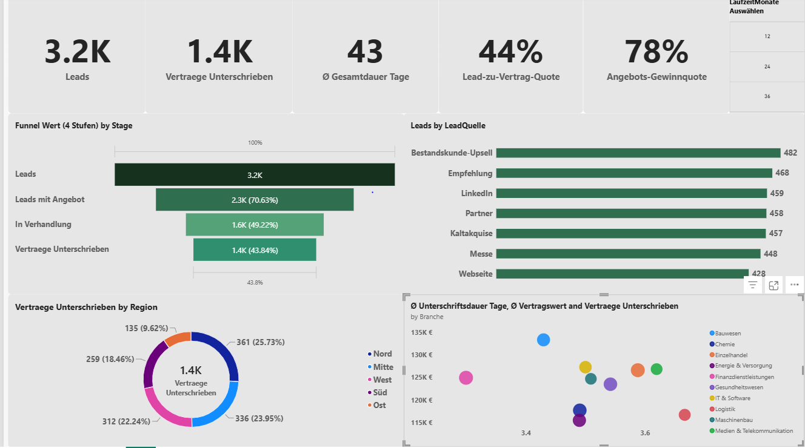
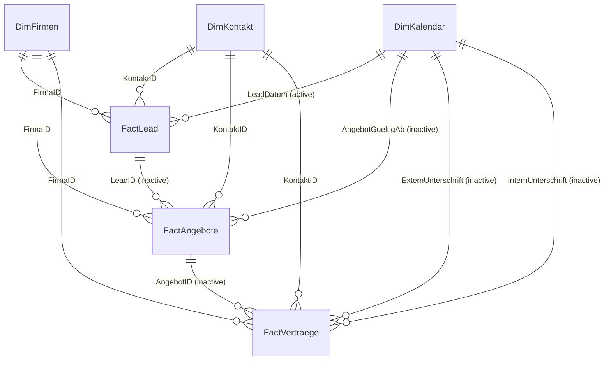

# B2B Sales Pipeline Analytics: Lead-to-Contract Process Optimization


> **Project type:** Portfolio case study. The scenario is framed as a strategic analytics initiative for a B2B telecommunications company.
> **Data note:** The dataset is a single flat file with 3,200 lead records. <!-- TODO: state whether the data is synthetic/anonymized --> 



---

## 1. Business Context

Sales leadership needs to see where deals are lost and how long each step of the lead-to-contract process takes. The source data is a single flat file (3,200 rows x 24 columns) covering every stage: lead, offer, and signed contract.

**Objectives**

1. Measure funnel conversion at each stage and find where cases drop out.
2. Measure cycle time for each process step and find the bottleneck.
3. Compare lead sources, industries, and regions by volume, conversion, and contract value.
4. Provide a reusable, well-modelled Power BI report for ongoing monitoring.

---

## 2. Key Results (from the dataset)

| Metric | Value |
|:---|---:|
| Leads | 3,200 |
| Offers created | 2,260 |
| Signed contracts | 1,403 |
| Lead-to-contract conversion | 43.8% |
| Offer win rate (won / won + rejected) | 78.2% |
| Total contract value (TCV) | EUR 173.5M |
| Average contract value | EUR 123.7K |
| Open pipeline (offers with status "Offen") | EUR 57.4M (467 offers) |
| Average / median lead-to-signature time | 42.6 / 43 days |

### Funnel

| Stage | Count | Note |
|:---|---:|:---|
| Leads | 3,200 | |
| Qualified (Qualifiziert, In Verhandlung, Gewonnen) | 2,260 | 70.6% of leads; 940 leads have status "Verloren" |
| Offers | 2,260 | |
| Signed contracts | 1,403 | 62.1% of offers; 43.8% of leads |
| Rejected offers | 390 | |
| Open offers | 467 | Still undecided |

### Process duration (days, contracts only)

| Step | Average | Share of total |
|:---|---:|---:|
| Lead to offer start | 15.0 | ~35% |
| Offer start to internal signature | 24.2 | ~57% |
| Internal to external signature | 3.5 | ~8% |
| **Lead to external signature** | **42.6** | 100% |

---

## 3. Findings and Recommendations

> Findings are descriptive results from the dataset. Recommendations are proposals, not implemented changes, and their impact has not been measured.

1. **The longest step is internal.** Offer start to internal signature takes 24.2 days on average, about 57% of the cycle, while customer signature takes 3.5 days. *Recommendation:* review the internal approval path, for example tiered approval thresholds by deal size, and measure the effect on this step.
2. **Lead sources convert almost equally.** Conversion ranges from 42.4% (Messe) to 45.1% (Webseite) across seven sources, so volume rather than conversion separates them. *Recommendation:* compare sources on acquisition cost, which this dataset does not contain, before shifting budget.
3. **Industries differ more in deal size than in conversion.** Average contract value ranges from about EUR 115K (Energie & Versorgung) to EUR 133K (Bauwesen). Conversion ranges from 40.2% (Chemie) to 46.1% (Medien & Telekommunikation). *Recommendation:* use the speed-vs-value scatter to pick segments for deeper review.
4. **Open pipeline is material.** EUR 57.4M sits in 467 open offers. *Recommendation:* add ageing of open offers to the report to flag stalled deals.

**Data quality note:** `Lead-Status = "Gewonnen"` appears on 1,115 leads, while 1,403 offers are won and have contracts. The status fields are not fully consistent, so the funnel stages in this project use offer and contract records for the later stages.

---

## 4. Data Model

The flat file is split in Power Query into a **6-table star schema** (3 dimensions, 3 fact tables).

| Table | Type | Rows | Description |
|:---|:---|---:|:---|
| `DimFirmen` | Dimension | 180 | Company, city, region, industry |
| `DimKontakt` | Dimension | 329 | Contact person per company |
| `DimKalendar` | Dimension | 1,948 | Date table, Sep 2024 to Oct 2029 |
| `FactLead` | Fact | 3,200 | One row per lead |
| `FactAngebote` | Fact | 2,260 | One row per offer |
| `FactVertraege` | Fact | 1,403 | One row per signed contract, with duration columns |



**Design decisions**

- **Staging query:** one `FlatFile_Raw` query (load disabled), referenced by all six tables.
- **Surrogate keys:** integer keys (`FirmaID`, `KontaktID`, `AngebotID`, `VertragID`) created in Power Query.
- **Role-playing date table:** one active relationship (`LeadDatum`) and three inactive ones activated per measure with `USERELATIONSHIP()`.
- **Single-direction filters** on all relationships, to avoid ambiguous paths across several fact tables.
- **Fact-to-fact relationships kept inactive** to avoid double counting.

---

## 5. DAX Measures

38 measures live in a hidden `_Measures` table, in eight groups: funnel counts, offer metrics, contract and revenue, duration KPIs, `USERELATIONSHIP` measures, period-over-period, funnel drop-off, conversion rates. Full list: [`dax/measures.dax`](dax/measures.dax).

```dax
Contract Volume by Ext Signature =
CALCULATE (
    SUM ( FactVertraege[VertragWertEUR] ),
    USERELATIONSHIP ( DimKalendar[Datum], FactVertraege[ExternUnterschrift] )
)

Annualized ARR =
SUMX (
    FactVertraege,
    DIVIDE ( FactVertraege[VertragWertEUR], FactVertraege[LaufzeitMonate] ) * 12
)

Funnel Waterfall =
SWITCH (
    SELECTEDVALUE ( FunnelStages[Stage] ),
    "Leads", [Leads],
    "Not Qualified", -[Dropoff Not Qualified],
    "No Offer", -[Dropoff No Offer],
    "Abandoned", -[Dropoff Abandoned],
    "Rejected", -[Dropoff Decision Against Us],
    "Signed", [Contracts Signed]
)
```

---

## 6. Dashboard

The report has 14 visuals: 6 KPI cards, a quarter slicer, a lead-source bar chart, a funnel drop-off waterfall, two quarterly trend combo charts, an industry donut, a regional revenue bar chart, and a speed-vs-deal-value scatter.

<!-- Add more screenshots to docs/images and reference them here -->

---

## 7. Tools and Skills Demonstrated

- **Power BI Desktop:** data modelling, report design, conditional formatting
- **Power Query (M):** staging queries, deduplication, merges, custom columns, date table
- **DAX:** `CALCULATE`, `SUMX`, `USERELATIONSHIP`, `DATEADD`, `SWITCH`, `DIVIDE`, variables
- **Sales Ops / RevOps analysis:** funnel conversion, cycle time, pipeline, segment comparison

---

## 8. Repository Structure

```
.
├── README.md
├── dax/
│   └── measures.dax
├── powerquery/
│   └── DimKalendar.m
├── docs/
│   └── images/            <- add dashboard screenshots here
└── PowerBI/
    └── <your_report>.pbix <- add your report file here
```

The raw dataset is not included by default. Add it only if you are allowed to publish it.

---

## 9. How to Reproduce

1. Open the `.pbix` file in Power BI Desktop (any version from March 2024 or later).
2. In Power Query, point `FlatFile_Raw` to your local copy of the source Excel file.
3. Refresh the model.

---

## 10. Author

**Emmanuel Adikaibe** | Sales Operations / RevOps Analyst | BI Analyst
[LinkedIn](https://www.linkedin.com/in/emmanuel-adikaibe-665364a7) | [Email](adiksemma@yahoo.com)
